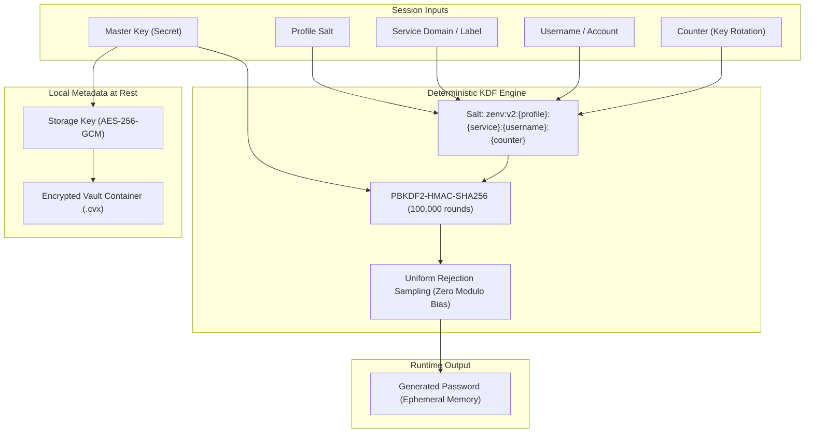

# ZenV

Deterministic, airgapped password and identity vault for Android and Web.

[](https://github.com/ashroxy/zenv/actions/workflows/ci.yml)
[](https://github.com/ashroxy/zenv/actions/workflows/deploy-pages.yml)
[](https://github.com/ashroxy/zenv)
[](https://github.com/ashroxy/zenv)
[](https://github.com/ashroxy/zenv)
[](LICENSE)
[](https://github.com/ashroxy/zenv/releases)

---

### Quick Access

* **Web Application (Live Sandbox):** [ashroxy.github.io/zenv](https://ashroxy.github.io/zenv/)
* **Android APK (Direct Download):** [GitHub Releases](https://github.com/ashroxy/zenv/releases/latest) *(Obtainium-compatible)*
* **Local Run:** `git clone https://github.com/ashroxy/zenv.git && cd zenv && npm i && npm run dev`

---



---

## Overview

ZenV calculates credentials mathematically from your master key on demand instead of storing them in a database. Plaintext passwords never touch disk storage.

Key architectural guarantees:
- **Stateless Derivation**: Credentials exist in memory only when displayed or copied, clearing automatically after 30 seconds.
- **OS-Enforced Airgap**: The release Android build omits `android.permission.INTERNET`. Socket creation is rejected directly by the operating system kernel.
- **Zero Remote Dependencies**: Zero telemetry, zero analytics SDKs, zero external CDNs. All interface fonts (Inter and JetBrains Mono) are vendored locally.
- **Authenticated Local Metadata**: Service labels, usernames, and rotation counters are stored locally under `AES-256-GCM` encryption stretched from a session secret.
- **Reproducible Verification**: CI gates strictly assert airgap manifests, lack of bundled credentials, zero remote network references, and 100% cryptographic test coverage.

---

## Cryptographic Architecture



### 1. Deterministic Password Derivation

```text
Master Key + Salt("zenv:v2:{profile}:{service}:{username}:{counter}")
    → PBKDF2-HMAC-SHA256 (100k iterations)
    → Uniform rejection sampling across character pool
    → Derived password
```

Password rotation requires no changes to your master key: incrementing the `:counter` generates a cryptographically distinct, unrelated pseudorandom output.

### 2. Vault Encryption at Rest

```text
Master Secret + Salt("zenv:v2:storage:{profile}")
    → PBKDF2-HMAC-SHA256 (100k iterations) → 256-bit AES-GCM Key
    → 96-bit Random IV + Ciphertext + Authentication Tag
```

Account configurations, custom character set flags, and counter values are stored with authenticated encryption. Exported backups (`.cvx` containers) use identical PBKDF2 + AES-256-GCM authenticated envelopes.

---

## Offline & Airgap Guarantees

ZenV enforces a zero-network invariant at four independent validation layers:

| Layer | Enforcement Mechanism | Verification Script |
| :--- | :--- | :--- |
| **Android OS** | `android.permission.INTERNET` is completely omitted from the release Android manifest. | `npm run verify:android-manifests` |
| **Web Content Security Policy** | Production CSP strictly enforces `connect-src 'none'` and forbids external scripts or evaluators. | `vite.config.ts` |
| **Local Bundled Assets** | All fonts (Inter, JetBrains Mono) and icons are bundled in `assets/fonts/`. No external CDN requests. | `npm run verify:no-remote-assets` |
| **Zero Secrets & Telemetry** | Build pipeline scans distribution bundles to guarantee no API keys or cloud tokens are packaged. | `npm run verify:no-secrets` |

---

## Repository Structure

```text
zenv/
├── android/                   # Native Android Capacitor shell
│   └── app/src/
│       ├── main/              # Release configuration (INTERNET permission omitted)
│       └── debug/             # Debug configuration (INTERNET enabled for live-reload)
├── assets/                    # Self-hosted web assets
│   └── fonts/                 # Inter & JetBrains Mono binary WOFF2 fonts + licenses
├── components/                # React UI components
│   ├── EditAccountModal.tsx   # Account creation, edit, & password preview modal
│   ├── ErrorBoundary.tsx      # React error containment layer
│   ├── Generator.tsx          # Dynamic password generation workbench
│   ├── Icons.tsx              # Lucide icon set
│   ├── Intro.tsx              # Boot sequence animation
│   ├── Manual.tsx             # Interactive offline user manual & security guide
│   ├── Settings.tsx           # Profile management, export/import, wipe, & lock
│   ├── UserSelect.tsx         # Multi-profile picker and registration
│   └── Vault.tsx              # Encrypted account listing with Quick Unlock
├── fastlane/                  # Metadata for IzzyOnDroid & F-Droid scrapers
│   └── metadata/android/en-US/# Title, descriptions, and icon
├── scripts/                   # Automated verification & build-gate checks
│   ├── assert-android-manifests.mjs   # Verifies release manifest lacks INTERNET
│   ├── assert-no-bundled-secrets.mjs  # Scans bundle for credentials & API tokens
│   └── assert-no-remote-assets.mjs    # Asserts zero remote dependencies or CDNs
├── services/                  # Business logic & Cryptography engines
│   ├── clipboard.ts           # Timed auto-clearing clipboard service
│   ├── cryptoUtils.ts         # PBKDF2, AES-GCM, & rejection sampling
│   ├── limits.ts              # Bounds and validation constants
│   ├── passwordGenerator.ts   # Derivation orchestration and legacy v1 compatibility
│   ├── schema.ts              # Runtime JSON validation schemas
│   └── storageService.ts      # Multi-profile AES-256-GCM storage service
├── types.ts                   # Core TypeScript interfaces & types
├── vite.config.ts             # Vite build pipeline with production CSP headers
└── vitest.config.ts           # Test runner configuration
```

---

## Getting Started

### Web (Local Development)

```bash
git clone https://github.com/ashroxy/zenv.git
cd zenv
npm install
npm run dev
```

### Prebuilt Android APK

Download the release `.apk` directly from [GitHub Releases](https://github.com/ashroxy/zenv/releases/latest).

To automate updates on Android, paste `https://github.com/ashroxy/zenv` into [Obtainium](https://github.com/ImranR98/Obtainium).

### Building Android from Source

**Prerequisites:** Node.js 20+, JDK 21, Android SDK / Android Studio.

```bash
npm run build
npx cap sync android
cd android
./gradlew assembleRelease
```

---

## Verification Suite

Every commit is validated through an automated seven-step verification suite:

```bash
npm run verify
```

The gate verifies:
1. **TypeScript Typecheck** (`tsc --noEmit`)
2. **ESLint Static Analysis** (`eslint .`)
3. **Vitest Test Suite** (69 tests covering cryptographic determinism, entropy distribution, storage error handling, schema parsing, and clipboard timers)
4. **Production Build** (Vite tree-shaking and asset packaging)
5. **No Secrets Scan** (Regex scan preventing API tokens from reaching `dist/`)
6. **No Remote Assets Check** (Asserts zero external CDNs or network fetches)
7. **Android Manifest Verification** (Asserts absence of `android.permission.INTERNET` in release builds)

---

## Cryptographic Specifications

| Parameter | Specification | Purpose |
| :--- | :--- | :--- |
| **KDF Algorithm** | `PBKDF2-HMAC-SHA256` | Key stretching against brute-force attacks |
| **KDF Iterations** | `100,000` | Computational hardness factor |
| **Symmetric Cipher** | `AES-GCM` (256-bit key) | Authenticated encryption at rest |
| **IV Size** | `96-bit` (12 bytes) cryptographically random | Nonce uniqueness per storage write |
| **Character Sampling** | Uniform Rejection Sampling | Eliminates modulo bias across custom pools |
| **Legacy Compatibility**| `v1` derivation preserved | Ensures existing passwords remain recoverable |

---

## License & Attribution

- **Source Code:** [AGPL-3.0-or-later](LICENSE). Requires sharing the source of any network-accessible derivative work.
- **Third-Party Notices:** See [NOTICE](NOTICE) for bundled font licenses (SIL OFL 1.1) and component attributions.
